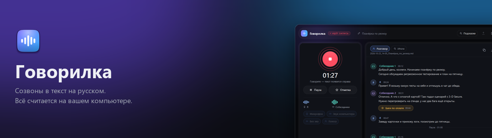
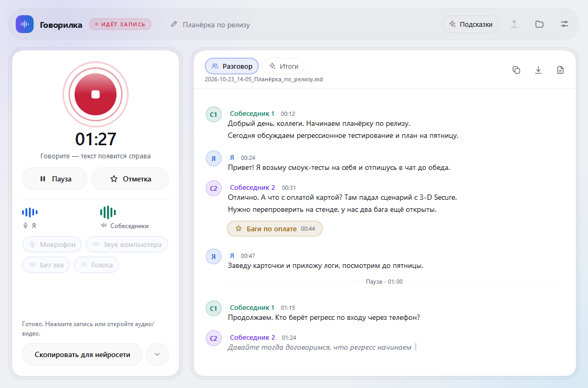
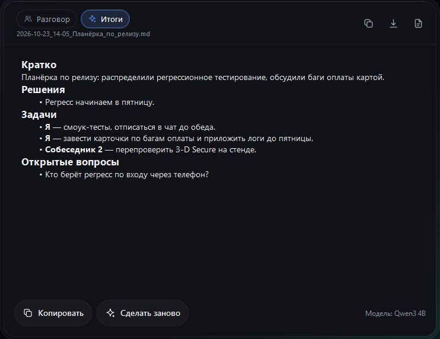
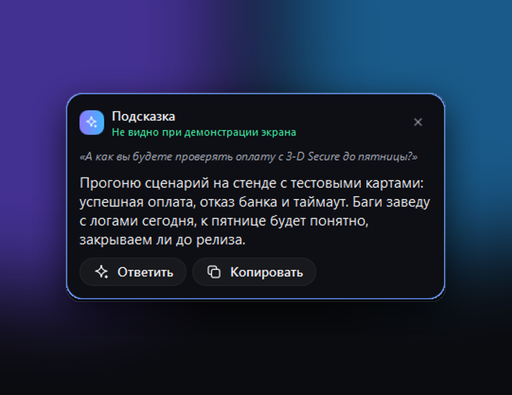

<p align="center">
  
</p>

<p align="center">
  <a href="https://github.com/fedintsevqq/govorilka/releases/latest"></a>
  <a href="https://github.com/fedintsevqq/govorilka/releases"></a>
  <a href="LICENSE"></a>
  
  <a href="https://github.com/fedintsevqq/govorilka/actions/workflows/release.yml"></a>
  <a href="https://github.com/fedintsevqq/govorilka/actions/workflows/models.yml"></a>
</p>

<h3 align="center">Созвон превращается в текст прямо во время разговора. Бесплатно, на русском, без облака.</h3>

<p align="center">
  <a href="https://github.com/fedintsevqq/govorilka/releases/latest"><b>Скачать</b></a> ·
  <a href="https://fedintsevqq.github.io/govorilka/">Сайт</a> ·
  <a href="docs/guide.md">Руководство</a> ·
  <a href="https://github.com/fedintsevqq/govorilka/discussions">Обсуждения</a> ·
  <a href="https://github.com/fedintsevqq/govorilka/issues">Ошибки и идеи</a>
</p>

<p align="center">
  <picture>
    <source media="(prefers-color-scheme: dark)" srcset="site/img/recording-dark.png">
    
  </picture>
</p>

## Что это

Говорилка пишет сразу два источника: ваш микрофон («Я») и всё, что играет в колонках или наушниках (Zoom, Teams,
Телемост, браузер). Текст появляется через секунду после фразы, собеседники различаются по голосам. После звонка
остаётся файл Markdown с разговором, итогами и задачами.

Всё считается на вашем компьютере. Аккаунта нет, бота в звонок приводить не нужно, звук на диск не сохраняется,
сохраняется только текст. Видеокарта не нужна.

## Возможности

| Возможность | Что делает |
|---|---|
| **Текст по ходу звонка** | Микрофон и звук компьютера отдельно, у каждого собеседника свой цвет и номер. Имена подставляются из разговора («меня зовут Аня») или вписываются вручную. |
| **Итоги и задачи** | Кратко, решения, кто что делает и к какому сроку, открытые вопросы. Пишет языковая модель на вашем же компьютере (Qwen или YandexGPT). |
| **Диктовка в любое окно** | Зажали Ctrl + Alt, сказали, отпустили: текст появился там, где стоит курсор. В браузере, Telegram, Word, где угодно. |
| **Файлы** | Аудио и видео любой длины: mp3, m4a, wav, mp4, mkv, mov. Двухчасовая запись Zoom не съест память. |
| **Десять моделей распознавания** | GigaAM v3 от Сбера для русского по умолчанию. Есть лёгкие для старых ноутбуков, телефонные, английские и многоязычные. |
| **Подсказки в звонке** | По желанию: когда собеседник задаёт вопрос, отвечает модель на компьютере или нейросеть по вашему ключу. Выключены по умолчанию. |
| **Нейросеть одним нажатием** | Разговор уходит в ChatGPT, Claude, Claude Code, Gemini, DeepSeek, GigaChat или Алису вместе с вашим запросом. |
| **Горячая клавиша и трей** | Запись стартует и останавливается комбинацией клавиш, окно можно держать свёрнутым. |

<table>
  <tr>
    <td width="50%"></td>
    <td width="50%"></td>
  </tr>
  <tr>
    <td align="center"><sub>Итоги созвона на локальной модели</sub></td>
    <td align="center"><sub>Подсказка во время звонка: ответ видите только вы</sub></td>
  </tr>
</table>

## Установка

Работает на **Windows 10 и 11**, на Mac с **Apple Silicon** (M1 и новее, macOS 14+) и на Mac с **Intel** (macOS 13+).

**Windows**, PowerShell:

```powershell
irm https://raw.githubusercontent.com/fedintsevqq/govorilka/main/install.ps1 | iex
```

**Mac**, Терминал:

```bash
curl -fsSL https://raw.githubusercontent.com/fedintsevqq/govorilka/main/install.sh | bash
```

**Mac через Homebrew:**

```bash
brew install --cask fedintsevqq/tap/govorilka
```

Или скачайте файл со страницы [релизов](https://github.com/fedintsevqq/govorilka/releases/latest): `windows-x64.exe` для Windows, `apple-silicon.dmg` для Mac с чипом M1 и новее, `intel.dmg` для Mac с Intel. Какой у вас чип, видно в меню Apple, «Об этом Mac».

Команда ставит программу без предупреждений «неизвестный издатель»: скрипт сам скачивает последний релиз с GitHub и сверяет его контрольную сумму. При первом запуске Говорилка скачает модели (около 880 МБ) и покажет процент. Дальше интернет не нужен.

<details>
<summary><b>Первый запуск на Mac</b></summary>

Приложение не подписано сертификатом Apple, и скачанный вручную файл macOS в первый раз не откроет. Закройте предупреждение и откройте «Системные настройки → Конфиденциальность и безопасность → Всё равно открыть». Или в Терминале:

```bash
xattr -dr com.apple.quarantine /Applications/Govorilka.app
```

При первой записи macOS спросит два доступа: к микрофону и к «записи экрана и системного звука». Нужны оба. Через второй macOS отдаёт звук собеседников, а видео Говорилка не пишет. После разрешения перезапустите приложение.
</details>

<details>
<summary><b>Первый запуск на Windows</b></summary>

SmartScreen может предупредить о неизвестном издателе: нажмите «Подробнее», потом «Выполнить в любом случае». Файл не подписан платным сертификатом. Контрольную сумму каждого релиза публикует GitHub, команда установки её проверяет.
</details>

## Как пользоваться

1. Впишите тему созвона вверху. Она попадёт в имя файла. Можно не вписывать.
2. Нажмите большую кнопку записи.
3. Текст идёт справа по ходу разговора. Серым курсивом показана фраза, которую ещё договаривают.
4. Нужное место отметьте кнопкой «Отметка»: в файле появится звёздочка со временем.
5. Нажмите кнопку ещё раз. Файл сохранится в «Загрузки/Govorilka», а вкладка «Итоги» составит краткое содержание.

Горячая клавиша по умолчанию: **Ctrl + Shift** на Windows и **Option + Command** на Mac, держать полсекунды. Подробности про круговое меню, имена, память голосов и отправку нейросети в [руководстве](docs/guide.md).

## Частые вопросы

<details>
<summary>Нужен ли интернет?</summary>

Только один раз, чтобы скачать модели. Запись, распознавание, итоги и диктовка работают без сети. Интернет нужен ещё для проверки обновлений (раз в сутки, выключается в настройках), для отправки разговора в чат нейросети и для режима «через нейросеть в интернете», если вы сами его включили.
</details>

<details>
<summary>Куда уходят мои разговоры?</summary>

Никуда. Звук не сохраняется, текст лежит в вашей папке и ни на какие серверы не отправляется. Исключение одно, и оно ваше: если вы нажали «Отправить нейросети» или включили подсказки через API, текст получит выбранный вами сервис.
</details>

<details>
<summary>Почему на Mac просят запись экрана?</summary>

Через этот доступ macOS отдаёт программе звук других приложений (собеседников из Zoom или браузера). Картинку экрана Говорилка не снимает и не сохраняет.
</details>

<details>
<summary>Сколько памяти и места нужно?</summary>

Модели распознавания занимают около гигабайта памяти, пока идёт запись; через десять минут без записи они выгружаются. На диске нужно около 1 ГБ для моделей, плюс 2,3 ГБ, если вы включите итоги на Qwen3 4B. Для итогов компьютеру нужно от 8 ГБ памяти, и Говорилка сама не даст выбрать модель, которая не запустится.
</details>

<details>
<summary>Как точно распознаёт?</summary>

GigaAM v3 ошибается примерно в 8 словах из 100 на русской речи по замерам [onnx-asr](https://istupakov.github.io/onnx-asr/comparison/) и сама ставит запятые и заглавные буквы. На вашем микрофоне и вашем акценте результат другой: сверьте на своих записях, а при необходимости выберите другую модель в настройках.
</details>

<details>
<summary>Работает ли на других языках?</summary>

Интерфейс только русский. Распознавать можно и другие языки: 25 европейских языков, в том числе английский (NVIDIA Parakeet), русский вместе с казахским, киргизским, узбекским и английским (GigaAM Multilingual). Итоги и подсказки рассчитаны на русский.
</details>

<details>
<summary>Как удалить?</summary>

Windows: удалите `Govorilka.exe` и папку `%LOCALAPPDATA%\Govorilka` (модели и настройки). Mac: перетащите Говорилку из «Программ» в корзину и удалите `~/Library/Application Support/Govorilka`. Через Homebrew: `brew uninstall --cask --zap govorilka`.
</details>

## Запись разговоров и ответственность

Говорилка пишет то, что слышит ваш компьютер, и больше ничего не перехватывает. Записывать разговоры, в которых вы
участвуете, для себя обычно можно. Но правила разные: в части стран и штатов нужно согласие всех участников, а
распространять запись чужого разговора без согласия нельзя почти везде. **Предупреждайте собеседников, что ведёте запись,
и соблюдайте законы своей страны и правила компании.** Программа ничего не передаёт сама: ответственность за запись и
за то, что с ней сделать, лежит на том, кто её ведёт. Это не юридическая консультация.

Что уходит с компьютера: только запрос к GitHub раз в сутки (проверка обновлений, виден ваш IP) и загрузка моделей.
Если включить режим «Через нейросеть в интернете» для подсказок или отправить разговор в чат, текст получит выбранный вами
сервис. Подсказки на собеседованиях и экзаменах обычно запрещены правилами, решение и ответственность за тем, кто пользуется.

## Документация

- [Руководство пользователя](docs/guide.md): все возможности, горячие клавиши, имена, модели, обновления.
- [Разработка](docs/development.md): запуск из исходников, тесты, сборка, устройство кода.
- [Сравнение с другими программами](docs/competitors.md) и [история изменений](CHANGELOG.md).
- [Решения по архитектуре](docs/adr).

## Участие

Нашли ошибку или хотите предложить идею? Откройте [обращение](https://github.com/fedintsevqq/govorilka/issues/new/choose) или
задайте вопрос в [обсуждениях](https://github.com/fedintsevqq/govorilka/discussions). Хотите поправить код или перевод,
прочитайте [CONTRIBUTING.md](CONTRIBUTING.md). О найденной уязвимости пишите по правилам из [SECURITY.md](SECURITY.md).

## Благодарности

Говорилка стоит на чужой работе: распознавание **GigaAM** от Сбера и библиотека **onnx-asr** Ильи Ступакова, детектор
речи **Silero VAD**, голоса различает **WeSpeaker**, итоги считает **llama.cpp** с моделями **Qwen** и **YandexGPT**,
интерфейс сделан на **Qt**. Полный список авторов и лицензий: [THIRD_PARTY_NOTICES.md](THIRD_PARTY_NOTICES.md).

## Лицензия

[MIT](LICENSE). Чужие компоненты, модели и их авторы перечислены в [THIRD_PARTY_NOTICES.md](THIRD_PARTY_NOTICES.md).
Модели распознавания и итогов скачиваются отдельно и идут под своими лицензиями.
